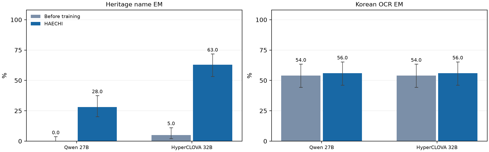

# 거대 언어-시각 통합 이해 / 생성 모델 V.2 (SW)

이미지와 텍스트를 함께 입력받아 한국어로 응답하는 HAECHI **27B·32B** 모델의 실행 코드, 학습 관련 코드·설정, 학습 전·후 평가 코드 및 성능 분석서를 제공합니다.

| 모델 | 기반 모델 | 공개 체크포인트 |
| --- | --- | --- |
| Qwen HAECHI 27B | `Qwen/Qwen3.5-27B` | [KETI-NLP/Qwen3.5-KETI-HAECHI-27B](https://huggingface.co/KETI-NLP/Qwen3.5-KETI-HAECHI-27B) |
| HyperCLOVA HAECHI 32B | `naver-hyperclovax/HyperCLOVAX-SEED-Think-32B` | [KETI-NLP/HyperCLOVA-X-KETI-HAECHI-32B](https://huggingface.co/KETI-NLP/HyperCLOVA-X-KETI-HAECHI-32B) |

모델 가중치와 가상환경은 Git에 포함하지 않습니다. 체크포인트는 위 저장소에서 내려받습니다.

## 문제 설명

국가유산 이미지에서 공식 명칭을 식별하고, 실외 이미지의 한글을 인식하여 텍스트로 생성합니다. 여기서 **생성은 이미지에 근거한 텍스트 응답 생성**을 뜻합니다.

```text
입력: 첨성대 이미지 + "사진 속 국가유산의 정확한 공식 명칭만 답하세요."
출력 예: 경주 첨성대

입력: 한글 간판 이미지 + "이미지에 보이는 한글 텍스트를 그대로 읽어 주세요."
출력: 이미지에 적힌 문자열
```

학습 전 기반 모델과 학습 후 HAECHI 모델에 같은 입력·전처리·생성 조건을 적용하여 미세조정에 따른 성능 변화를 비교합니다.

## 실험 설정

- 분석서 V2.0: 국가유산 명칭 식별 100문항과 실외 한글 OCR 100문항. 두 모델 계열의 학습 전·후 **총 800개 응답**을 비교합니다.
- 기존 평가 원본에는 별도로 국가유산 지식 질문 100문항도 남아 있습니다. 이 추가 과제는 V2.0 분석서의 두 과제 집계와 구분합니다.
- 평가 환경: NVIDIA A100 80GB, 물리 GPU 3번 한 장, BF16, thinking 비활성화, greedy decoding.
- 이미지 긴 변 최대 512픽셀. 프로세서 최소 65,536 / 최대 262,144픽셀. 생성 예산은 국가유산 명칭 64토큰, OCR 128토큰입니다.
- Python 3.12, PyTorch 2.9.1, torchvision 0.24.1. 모델별 Transformers 환경을 분리합니다.
- Qwen 평가에는 visual patch projection의 동등 선형 연산과 평가용 커널을 사용했습니다. [수치 동등성 기록](evaluation/2026-11-16/patch_projection_equivalence.json)과 [실행 메타데이터](evaluation/2026-11-16/qwen_haechi_run.json)를 함께 제공합니다.

국가유산 표본과 학습 데이터 사이의 개체·이미지 비중복은 독립적으로 검증하지 않았습니다. 결과는 이 고정 표본에서의 관측치이며, 독립적인 일반화 성능과 구분하여 해석합니다.

## 저장소 구성

| 경로 | 내용 |
| --- | --- |
| [haechi.py](haechi.py), [run.sh](run.sh) | 모델 다운로드와 이미지·텍스트 추론 |
| [setup.sh](setup.sh), `requirements-*.txt` | 모델별 환경 설치와 검증 환경의 패키지 목록 |
| [training/](training/README.md) | 공통 SFT 코드, 27B·32B 학습 레시피와 체크포인트 변환·배포 도구 |
| [evaluation/2026-11-16/](evaluation/README.md) | 고정 입력·정답, 추론·채점 코드, 저장 응답 및 측정 결과 |
| [evaluation/2026-11-17-llm-judge/](evaluation/2026-11-17-llm-judge/README.md) | 추가 지식 응답의 LLM 자동 채점 코드·기록 |
| [docs/reports/](docs/reports/) | 성능 분석서 PDF 원본 |
| [SOURCE_MANIFEST.json](SOURCE_MANIFEST.json) | 공개 파일과 복사 원본의 SHA-256 |

## 필요 패키지 설치

Linux, Python 3.10 이상(검증 3.12), Git, NVIDIA CUDA 환경이 필요합니다. 두 모델의 가중치는 합계 약 121GB이며, 설치 공간을 포함해 180GB 이상의 여유 디스크를 권장합니다. 기본 실행 코드는 **물리 GPU 3번**을 사용합니다.

```bash
git clone https://github.com/MMC-K/MMC2_VLM_HAECHI.git
cd MMC2_VLM_HAECHI

# 필요한 모델의 환경만 설치해도 됩니다.
bash setup.sh qwen
bash setup.sh hyperclova
```

Qwen은 지정 Transformers 커밋, HyperCLOVA는 Transformers 4.x를 사용합니다. 전체 패키지 버전은 `requirements-qwen.lock.txt`, `requirements-hyperclova.lock.txt`를 참고하세요. 학습 환경은 [학습 안내](training/README.md)에 별도로 설명합니다.

## 모델 다운로드

검증한 리비전을 지정하면 같은 체크포인트를 받습니다.

```bash
.venv-qwen/bin/python haechi.py download --model qwen \
  --revision 259830921a2f45322018c496b123ce075511286e
.venv-hyperclova/bin/python haechi.py download --model hyperclova \
  --revision 776bf4ac7207f47f171a00b81ac4f161880f156d
```

기본 저장 경로는 `models/qwen`, `models/hyperclova`입니다. 접근 인증이 필요한 경우 각 환경의 `hf auth login`을 사용합니다.

## 모델 학습

[training/README.md](training/README.md)에 학습 코드의 역할, 입력 데이터 형식, 분산 학습 환경 및 원본 레시피의 의존성을 정리했습니다.

| 계열 | 학습 관련 코드·문서 |
| --- | --- |
| Qwen 27B | [SFT 구현](training/generic_sft/VLM_SFT_Custom_Data_Qwen3_5/3_vlm_sft_distributed.py), [원본 단계별 설정](training/large_models/qwen/configs/), [학습·평가 연계 스크립트](training/large_models/qwen/reproduction/run_end_to_end.sh) |
| HyperCLOVA 32B | [SFT 구현](training/generic_sft/VLM_SFT_Custom_Data_HyperClovaX/3_vlm_sft_distributed.py), [원본 학습 설정](training/large_models/hyperclova/reports/TRAINING_CONFIG.yaml), [BF16 변환](training/large_models/hyperclova/reproduction/convert_hf_safetensors_to_bf16.py) |

`generic_sft`는 기존 공통 학습 구현이고, `large_models`는 배포 체크포인트에 동봉된 실제 실험 설정·문서입니다. 원본 128-GPU 학습 레시피는 별도 클러스터의 데이터·컨테이너·`sft_training_code`에 의존하므로, 공통 SFT 명령과 동일한 학습 실행으로 취급하지 않습니다. 원본 학습을 이 저장소만으로 완전히 재실행할 수 있는 구성은 아닙니다.

## 모델 테스트 및 평가

다운로드한 예제 이미지로 실행합니다. 두 모델은 한 번에 하나씩 실행하세요.

```bash
bash run.sh qwen --sample \
  --prompt '사진 속 국가유산의 정확한 공식 명칭만 답하세요. 설명은 쓰지 마세요.' \
  --max-new-tokens 32
bash run.sh hyperclova --sample \
  --prompt '사진 속 국가유산의 정확한 공식 명칭만 답하세요. 설명은 쓰지 마세요.' \
  --max-new-tokens 32

# 직접 준비한 이미지
bash run.sh qwen --image ./photo.jpg --prompt '이미지 속 한글을 읽어 주세요.'
```

전체 고정 표본 평가 및 저장 응답 재채점:

```bash
# 학습 후 HAECHI 평가. 각 모델 다운로드를 먼저 완료합니다.
.venv-qwen/bin/python evaluation/2026-11-16/run_benchmark.py --model qwen --stage haechi
.venv-hyperclova/bin/python evaluation/2026-11-16/run_benchmark.py --model hyperclova --stage haechi

# 저장 응답으로 점수 재집계: 표준 Python만 사용하며 GPU가 필요 없습니다.
python evaluation/2026-11-16/score_results.py

# 원본 입력·이미지 해시와 저장 응답·분석서 핵심 수치 검증
python scripts/verify_release.py
```

평가 재실행은 기존 출력이 있으면 이어서 실행합니다. 새로 측정하려면 `--output-tag rerun1`처럼 별도 이름을 사용합니다. 학습 전 모델 준비, 평가용 추가 커널과 기록 해석은 [평가 안내](evaluation/README.md)를 참고하세요. 원본 로컬 실행 설명은 [LOCAL_INFERENCE.md](docs/LOCAL_INFERENCE.md)에 보존했습니다.

## 실험 결과

아래 값은 **첨부 V2.0 분석서와 2026-11-16 저장 응답**을 기준으로 하며 단위는 %입니다. EM은 정규화 일치율입니다. CER은 낮을수록 좋습니다.

| 모델 | 국가유산 명칭 EM 전 → 후 | OCR EM 전 → 후 | OCR 엄격 일치율 전 → 후 | OCR CER 전 → 후 |
| --- | ---: | ---: | ---: | ---: |
| Qwen 27B | 0.00 → 28.00 | 54.00 → 56.00 | 34.00 → 41.00 | 62.56 → 44.67 |
| HyperCLOVA 32B | 5.00 → 63.00 | 54.00 → 56.00 | 42.00 → 41.00 | 66.35 → 58.53 |

국가유산 명칭 식별은 두 계열 모두 향상되었습니다. OCR은 문자 오류량이 줄었으나, HyperCLOVA의 전체 문자열 엄격 일치율은 1%p 낮아졌습니다. 명칭 EM 개선을 모든 생성 과제의 성능 개선으로 확대 해석하지 않습니다.



원본 [summary.json](evaluation/2026-11-16/summary.json)에 문항 수, 신뢰구간, 생성 지연 및 GPU 메모리 측정 결과를 보존했습니다. 추가 지식 응답 채점은 별도 기록이며 위 두 과제 결과에 합산하지 않습니다.

## 성능 분석서

[**[기술문서] 거대 언어-시각 통합 이해_생성 모델 성능 분석서 2 V2.0.pdf**](docs/reports/%5B기술문서%5D%20거대%20언어-시각%20통합%20이해_생성%20모델%20성능%20분석서%202%20V2.0.pdf)

평가 목적, 입력과 설정, 학습 전·후 성능, 지연·메모리, 응답 사례 및 한계를 포함합니다. PDF는 제공된 원본 그대로 첨부했으며 SHA-256은 `SOURCE_MANIFEST.json`에 기록했습니다.

## 공개 이력 및 이용 조건

기존 코드와 실험 자료를 프로젝트 구축 순서에 따라 **총 150개 커밋으로 재구성**했습니다. 실제 과거 개발 이력을 복원하거나 커밋 시각을 소급한 것은 아닙니다. 자세한 구성은 [HISTORY.md](docs/HISTORY.md)를 참고하세요.

모델 및 원천 데이터의 이용 조건은 각 배포처의 조건을 따릅니다. Qwen 계열은 동봉 [라이선스](training/large_models/qwen/LICENSE), HyperCLOVA 계열은 [라이선스](training/large_models/hyperclova/LICENSE)와 [NOTICE](training/large_models/hyperclova/NOTICE)를 확인하세요. 공통 학습 코드의 라이선스·제3자 고지는 [generic_sft](training/generic_sft/)에 보존했습니다.

## Acknowledgement

본 연구는 정부(과학기술정보통신부)의 재원으로 지원을 받아 수행된 연구입니다. (No. RS-2022-II220320, 상황인지 및 사용자 이해를 통한 인공지능 기반 1:1 복합대화 기술 개발)
